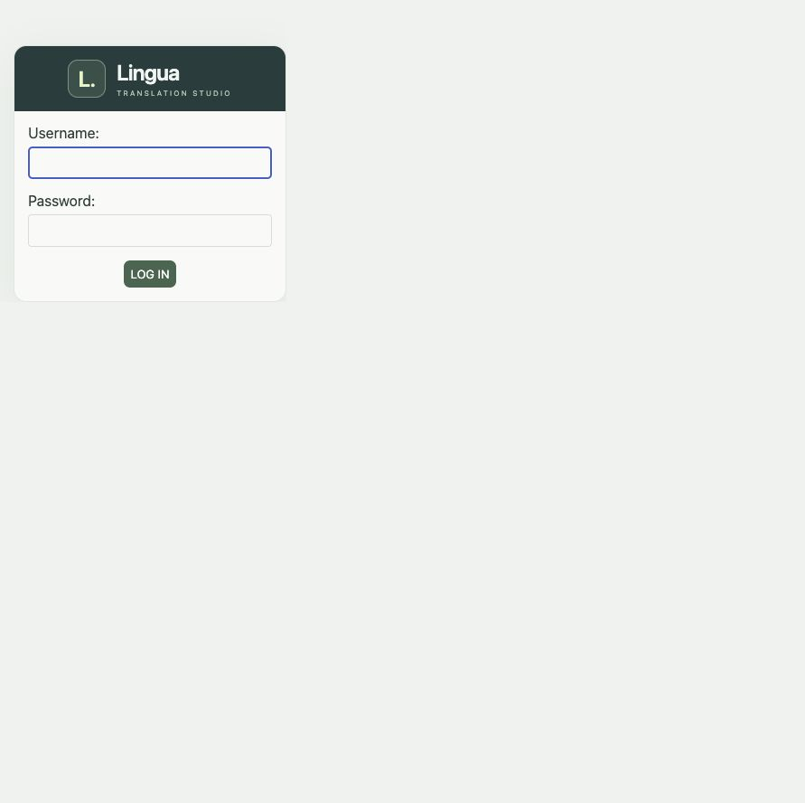

# CustomJSONView · Translation studio

**Edit multilingual JSON content through labelled fields in Django admin.**

A small, reusable example for storing translations in a single `JSONField` while giving editors a language-aware interface. The refreshed admin uses a restrained green palette, readable text, labelled language cards, and textareas that support both left-to-right and right-to-left content.

```json
{
  "en": "A world of stories",
  "fr": "Un monde de récits",
  "ar": "عالم من القصص"
}
```



## Is this still relevant?

**Yes, as a focused admin editing pattern and learning example.** Django already provides JSON storage and a generic JSON form field, but an object such as `{"en": "Hello", "fr": "Bonjour"}` still benefits from named language inputs instead of asking content editors to write raw JSON.

Use this approach when you have a small language set, existing JSON translations, and straightforward administrative editing. It keeps translations in one database column and changing the language list does not require adding database columns.

For a larger localization product, evaluate dedicated model-translation libraries or normalized translation tables. This project does not provide fallback-language resolution, translated slugs/URLs, translation workflows, per-language permissions, query optimization, or conflict resolution for simultaneous edits. If those requirements dominate, a custom JSON editor alone is insufficient.

| Approach | Good fit | Tradeoff |
| --- | --- | --- |
| This JSONField editor | Small multilingual admin forms; existing JSON data | Application owns fallback, querying and concurrent-edit behavior |
| Django's normal JSONField form | Arbitrary structured data for technical users | Editors interact with raw JSON |
| `django-modeltranslation` | Translated model attributes with same-table storage and admin integration | Language-specific fields and additional integration |
| `django-parler` | Separate translation records and fallback behavior | Translation tables and additional integration |

Check each third-party package's current Django compatibility before adopting it. The translation editor itself uses only Django's public form APIs.

## Current stack

- **Django 6.1.2**, upgraded from unsupported Django 4.1.6.
- **Python 3.12–3.14** for the supported Django 6.1.2 environment.
- SQLite by default; PostgreSQL is optional via `DATABASE_URL` and Psycopg 3.
- Updated `django-environ` and the legacy `django-mptt` dependency.

As checked on 2 November 2026, Django lists 6.1.2 as the latest release. Django 5.2 LTS is an alternative for teams that prefer its longer support window. See [Django's release/support table](https://www.djangoproject.com/download/).

## Quick start

```sh
git clone https://github.com/ganeshkg04/CustomJSONView.git
cd CustomJSONView
python3.14 -m venv .venv
source .venv/bin/activate
python -m pip install -r requirements.txt
cp .env.example .env
python manage.py migrate
python manage.py createsuperuser
python manage.py seed_demo
python manage.py runserver
```

Open `http://127.0.0.1:8000/`, sign in with the account you created, and choose **Sample models**. The seed command adds one fictional multilingual record and creates no users. It is safe to run repeatedly.

On Windows use `py -3.14 -m venv .venv` and `.venv\Scripts\activate`. Python 3.12 or 3.13 also works with this dependency target.

The example `.env` enables local debug mode. Without it, set `DEBUG=True` explicitly for local commands, or provide a stable `SECRET_KEY` for non-debug configuration. No production key or default admin password is included.

## Reuse the field

Configure your languages and default language:

```python
LANGUAGES = [
    ("en", "English"),
    ("fr", "French"),
    ("ar", "Arabic"),
]
DEFAULT_LANGUAGE_CODE = "en"
```

Use the custom field on any model:

```python
from django.db import models
from core.CustomFields import JsonFieldWithTranslation

class Article(models.Model):
    title = JsonFieldWithTranslation()
    body = JsonFieldWithTranslation()
```

Register it using an ordinary `ModelAdmin`:

```python
from django.contrib import admin
from .models import Article

@admin.register(Article)
class ArticleAdmin(admin.ModelAdmin):
    fields = ("title", "body")
```

The editor works with plain `ModelForm` classes and explicit admin `fields`/`fieldsets`. The old `CustomModelAdmin` import remains available as a compatibility alias; inheriting from it is no longer required. Keep `translationapp` in `INSTALLED_APPS` so Django can find the widget template and stylesheet, or move those resources into your own installed app when extracting the pattern.

### Editing behavior

- Each configured language gets a labelled textarea with stable names such as `title_en` and `title_fr`.
- The configured default language is required unless the model field uses `blank=True`.
- Other language inputs may be empty; empty strings are stored explicitly.
- `lang` and `dir="auto"` support language-aware input, including Arabic text.
- Language codes such as `pt-br` and `en_us` are treated as keys, not parsed from generated field names.
- Existing keys for languages not currently configured are preserved during form saves. Removing a language from settings does not silently delete its stored translation.
- Ordinary `JSONField` values, such as the sample's author metadata, keep Django's normal JSON editor.
- Form fields and initial values are isolated per instance/request; no random suffixes or shared form mutation are used.

Direct ORM updates still accept JSON according to Django's JSONField rules. The language-input validation belongs to the form layer. Concurrent edits follow normal Django model-save behavior; use locking/versioning if multiple editors need conflict protection.

## PostgreSQL

```sh
python -m pip install -r requirements-postgres.txt
```

Set `DATABASE_URL` to your own PostgreSQL URL in the ignored `.env`, then run migrations against that database. Configure production PostgreSQL TLS and access controls as appropriate for your deployment.

## Upgrade notes

1. Back up the existing database and configuration first. Use a new virtual environment with a supported Python version.
2. Replace `DB_NAME`, `DB_USER`, `DB_PASSWORD`, `DB_HOST`, and `DB_PORT` settings with `DATABASE_URL`. The old individual-variable configuration is no longer read.
3. Keep existing `core.CustomFields.JsonFieldWithTranslation` imports in historical migrations. That module path is deliberately preserved.
4. The rewritten editor does not require a schema migration; existing language-keyed JSON data is retained. Run `manage.py migrate` to apply Django's own outstanding migrations.
5. Custom code relying on the old randomly generated form input names must adopt stable names such as `title_en`.
6. The unrelated MPTT sample model and its original migration remain to avoid dropping existing tables. The dependency is retained for compatibility, although its maintainers describe it as best-effort maintenance. The translation editor does not depend on tree behavior. Remove that demonstration only through a planned model/data migration.
7. The tracked `.env` was removed. Its historical contents remain in Git history; rotate any real keys or database credentials it contained before publishing or deploying.

The missing `django_admin_json_editor` app entry was removed; no undeclared package is required to start the demo.

## Validation

```sh
python manage.py check
python -Wa manage.py test
python manage.py makemigrations --check --dry-run
python manage.py collectstatic --noinput
```

Seventeen tests cover default-language requirements, optional translations and clearing, Unicode, escaping, stable language inputs, bad configuration, request isolation, admin add/save/validation, explicit fieldsets, standard JSON fields, and preservation of unconfigured language keys.

Local system checks, all tests, migrations, migration-drift checks, and static collection pass. The available local interpreter was Python 3.15.2, which is outside the published Django 6.1.2 Python support matrix; those results do not establish supported Python 3.15 compatibility. GitHub Actions is configured to repeat checks on Python 3.12, 3.13, and 3.14 after publication. Those remote jobs have not been run yet. PostgreSQL integration has not been exercised locally.

Visual verification covered the refreshed login screen. Authenticated admin rendering and save behavior were verified through Django's test client, without provisioning a persistent preview superuser.

## Project layout

```text
core/CustomFields.py                       Model field; stable migration import path
core/translation_forms.py                  MultiValueField / MultiWidget implementation
core/CustomAdmin.py                        Compatibility admin class
core/settings.py                          Typed environment and database settings
translationapp/templates/translationapp/   Labelled widget template
translationapp/static/translationapp/      Editor and admin styling
templates/admin/base_site.html             Admin branding
translationapp/tests.py                    Regression tests
translationapp/management/commands/        Idempotent fictional sample data
.github/workflows/tests.yml                Supported-Python checks
```

## References

- [Django JSONField](https://docs.djangoproject.com/en/6.1/ref/models/fields/#jsonfield)
- [Django MultiWidget](https://docs.djangoproject.com/en/6.1/ref/forms/widgets/#multiwidget)
- [Django supported Python versions](https://docs.djangoproject.com/en/6.1/faq/install/#what-python-version-can-i-use-with-django)
- [django-modeltranslation](https://django-modeltranslation.readthedocs.io/en/latest/)
- [django-parler](https://django-parler.readthedocs.io/en/stable/)
- [django-mptt maintenance status](https://pypi.org/project/django-mptt/)

The original screenshots under `screenshots/` show the historical Django 4.1 interface, not the refreshed theme.
